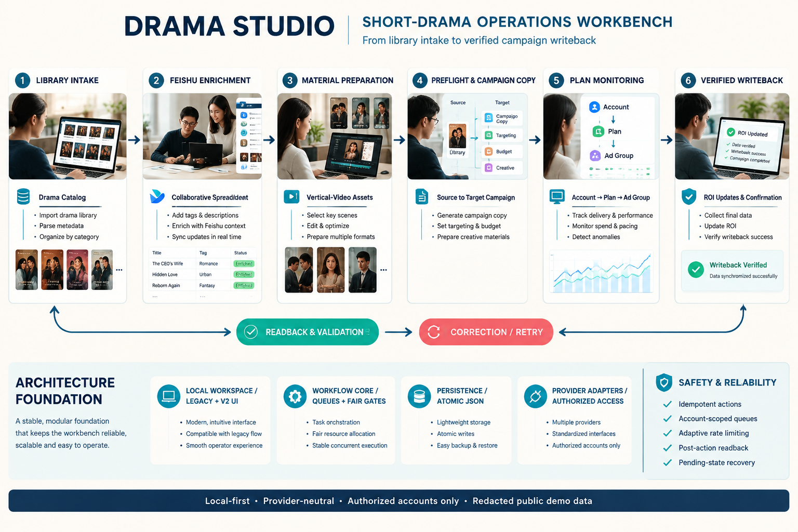

<div align="center">

<picture>
  
</picture>

# drama-studio · Short-Drama Studio

**Turn a scene-based script into a production pack of 15-second slice prompts, ready to feed an AI video model.**

[](#)
[](#hard-constraints-enforced-by-code)
[](#install-as-an-agent-skill)
[](LICENSE)

[Start here](#start-here) · [Three stages](#why-these-three-stages) · [Hard constraints](#hard-constraints-enforced-by-code) · [Quick start](#one-minute-quick-start) · [Install](#install-as-an-agent-skill)

English · [中文](README.zh.md)

</div>

Updated: **2026-10-18** · **v1.0.0** · English is the default documentation; the Chinese edition lives at [`README.zh.md`](README.zh.md), with `SKILL.md` (Chinese) / [`SKILL.en.md`](SKILL.en.md) as the agent entry and [`references/en/`](references/en/) mirroring the Chinese references.

One pipeline, three stages, every step guarded by code-level quality gates:

```
scene script ──▶ assets (character four-views / scene plates + @UUID) ──▶ storyboard (15s slices + shot language + continuity chain) ──▶ generation (fixed-template prompts + four-gate acceptance)
```

Not a prompt collection — a stateful, verifiable, repairable production line. Not bound to any platform, API, or model: Dreamina, Seedance, or any other entry point works; execution stays in the user's hands.

<a id="start-here"></a>

## Start here

| You are | Open first |
|---|---|
| New here | This page → [Quick start](#one-minute-quick-start) → the complete `examples/三打白骨精-*` sample |
| Agent integrator | [`SKILL.md`](SKILL.md) (Chinese) / [`SKILL.en.md`](SKILL.en.md) (English) — the three-stage workflow and command reference |
| Changing slicing rules | [`references/stage-2-storyboard.md`](references/stage-2-storyboard.md) — the six slicing laws + shot language |
| Changing asset output | [`references/stage-1-assets.md`](references/stage-1-assets.md) — character four-views, layered scene objects |
| Changing prompt compilation | [`references/stage-3-generation.md`](references/stage-3-generation.md) — template anatomy, four acceptance gates, five repair verdicts |
| Debugging a failing gate | [`references/quality-gates.md`](references/quality-gates.md) — all 26 gates and their diagnostic messages |

## Why these three stages

| Stage | Question it answers | Output |
|---|---|---|
| 1 Assets | Who is on screen, where are we, what is in their hands? | `assets.json`: appearance/costume prompts + layered object lists + UUIDs + reference-image status |
| 2 Storyboard | What happens in these 15 seconds, who stands where, how does the camera speak, which lines are said? | `storyboard.json`: slices + shot language + continuity chain |
| 3 Generation | What does the platform-facing prompt look like, how is the take verified, how is a failure repaired? | `slices.md`: copy-paste-ready slice prompts |

<a id="hard-constraints-enforced-by-code"></a>

## Hard constraints (all enforced by quality gates)

- Each slice is exactly **15 seconds**;
- Each slice carries **25-35 Chinese characters** of dialogue (max 40 for intense confrontation), **verbatim** from the script — not added, not dropped, not reworded;
- Each slice holds **3-5 effective action units**; complex conflicts must be split;
- Cuts land only on: end of a line / entrance / exit / major action turn / emotional pause;
- **The previous slice's ending action is the next slice's opening frame** (hard-checked by the `continuity` gate);
- Each slice carries one line of **shot language** (size tier / camera position / move / composition / edit relation, ≤80 chars);
- Chain depth ≤3; beyond that, re-anchor from the character/scene masters;
- Characters and scenes are always bound via `@UUID` references; text carries only the increment;
- The template header is verbatim-immutable; field order never moves.

<a id="one-minute-quick-start"></a>

## One-minute quick start

```bash
# 1. Parse the script (strict format, see references/script-format.md)
python scripts/drama_studio.py parse-script project-script.md --title Project --out project-scenes.json

# 2. Seed the asset registry, fill it in, then validate (a reference image must exist first)
python scripts/drama_studio.py seed-assets project-scenes.json --out project-assets.json
python scripts/drama_studio.py uuid-new Rinsheng Takashi Kaita
python scripts/drama_studio.py validate-assets project-assets.json --scenes project-scenes.json
# Characters: stylist prompt fills appearance/costume → build-sheets assembles the four-view prompt → generate & upload
python scripts/drama_studio.py build-sheets project-assets.json --apply
# Scenes: art-director prompt fills the layered object list → hand-write the plate sheetPrompt (with the no-text clause)

# 3. Storyboard: fill slices per references/stage-2-storyboard.md, validate until every gate passes
python scripts/drama_studio.py seed-storyboard project-scenes.json --aspect 9:16 --out project-storyboard.json
python scripts/drama_studio.py validate-storyboard project-storyboard.json --scenes project-scenes.json --assets project-assets.json

# 4. Compile slice prompts (compilation is refused while any gate fails)
python scripts/drama_studio.py compile-slices project-storyboard.json --assets project-assets.json --scenes project-scenes.json --out project-slices.md
```

`examples/三打白骨精-*` is a complete worked sample (script → assets → 14 slices → slices.md → report). Copying from it is the fastest way in.

## A compiled slice looks like this

```text
真实电影风格。无BGM。无字幕。风格要求真实，镜头切换自然。
人物：@a9cf0873-e937-4657-8eb0-a2d7dd2f77c2是孙悟空。@f44f5bb2-4cbf-468e-be1f-fe8ddca78d0d是唐僧。@fc55e7ef-0539-4d24-b8e6-63ab5f0f008c是猪八戒。@9ddcf00e-bfb0-480b-8b86-25e914befbbe是沙僧。
场景：@3d1393e6-f6bd-4bac-8c7e-1c8a5ae6efb6是白虎岭古道。
景别：中景。
运镜：推镜。
镜头语言：中景平视，机位略低于马背缓推，唐僧与猴王分置画面左右，马颈作前景压住下缘，收在云影没入雾中。
画面内容：坡上停留处，唐僧扶鞍，悟空立于马侧，唐僧松开缰绳，按住腹部，抬眼看悟空；孙悟空收棒抱拳应命，转身一纵，脚踏云头翻过山脊；猪八戒把担子撂在地上，靠着石头坐下，沙僧持杖四望。
{唐僧（气息虚弱）：悟空，为师腹中饥饿，你去南山摘些桃子来。}
{孙悟空（抱拳）：师父稍等，弟子去去就回，八戒沙僧守好行李。}
```

(The slice prompt template is Chinese-native by design — it is the working language of the target platforms. See [`assets/templates/slice-prompt.md`](assets/templates/slice-prompt.md).)

<a id="install-as-an-agent-skill"></a>

## Install as an Agent Skill

```bash
# Claude Code
cp -r drama-studio ~/.claude/skills/
# Codex / any SKILL.md-compatible client: copy into its skills directory, or let the agent read SKILL.md directly
```

Self-contained and copyable: Python ≥3.8 standard library only, no model calls, no quota, fully offline self-test.

```bash
python scripts/selftest.py   # 106 assertions (including bilingual-mirror consistency), ~1 second
```

## Directory

```
drama-studio/
├── README.md                This document (English, default)
├── README.zh.md             Chinese edition
├── SKILL.md                 Agent entry (Chinese)
├── SKILL.en.md              Agent entry (English mirror)
├── scripts/
│   ├── drama_studio.py      Deterministic tooling (parse / seed / validate / compile / render)
│   └── selftest.py          Self-test (106 assertions, no model calls)
├── references/              Chinese references
│   ├── script-format.md         Input script format spec
│   ├── stage-1-assets.md        Assets stage: four-views, layered objects, UUID registry
│   ├── stage-2-storyboard.md    Storyboard stage: six slicing laws and data model
│   ├── stage-3-generation.md    Generation stage: compilation, four gates, five verdicts
│   ├── quality-gates.md         All 26 quality gates and design principles
│   └── en/                      English mirrors (one-to-one)
├── assets/
│   ├── pipeline-en.png          Pipeline architecture diagram (English)
│   ├── pipeline-zh.png          Pipeline architecture diagram (Chinese)
│   └── templates/               Prompt templates and intake sheets (Chinese-native: the prompts themselves ship in Chinese)
│       ├── character-extract.md      Character extraction prompt (stylist) + four-view prefix
│       ├── scene-extract.md          Scene extraction prompt (art director) + plate style
│       ├── asset-intake.md           Asset registry (field dictionary + workflow)
│       └── production-brief.md       Production brief
└── examples/                    Complete White Bone Demon sample (doubles as the self-test fixture)
```

> Language convention: slice prompts, extraction prompts, and sample data stay Chinese-native (that is their working language); documentation ships bilingual — English is the default display (`README.md`, `SKILL.en.md`, `references/en/`), with Chinese at `README.zh.md`, `SKILL.md`, and `references/`. The self-test checks that the mirrors are complete.

## What it learned from whom

- **shuohao-skills**: JSON as single source of truth + scripts for validation and rendering; `seed` commands for deterministic upstream transfer; code-level quality gates with per-item diagnostics; verbatim-dialogue and coverage gates.
- **dramake**: three-state lifecycle (`generated ≠ accepted`, observed state overrides planned); generation-block event-load budgeting; four acceptance gates with P0 rulings; one-variable retries + attempt budgets; reference roles and must-not-transfer.
- **seedance-2.0-os**: prompts are compiled, not written; identity fidelity offloaded to reference images; anti-slop (no empty evaluators); retake economics (five verdicts + shot log); chain-depth caps and re-anchoring; English-default documentation layout (hero image + badges + anchor navigation + language switcher).
- **Your battle-tested patterns**: the 15-second slice prompt (fixed template header, UUID references, 25-35 characters, 3-5 action units, cut rules, previous-slice ending = next-slice opening) is preserved verbatim and encoded as gates; asset output uses your two proven pipelines — characters = stylist "appearance + costume" two-part prompt assembled into a white-background four-view sheet (16:9), scenes = art-director layered object list (core/environment/implied) written into a plate prompt (with the no-readable-text clause).

## License

[MIT](LICENSE)
